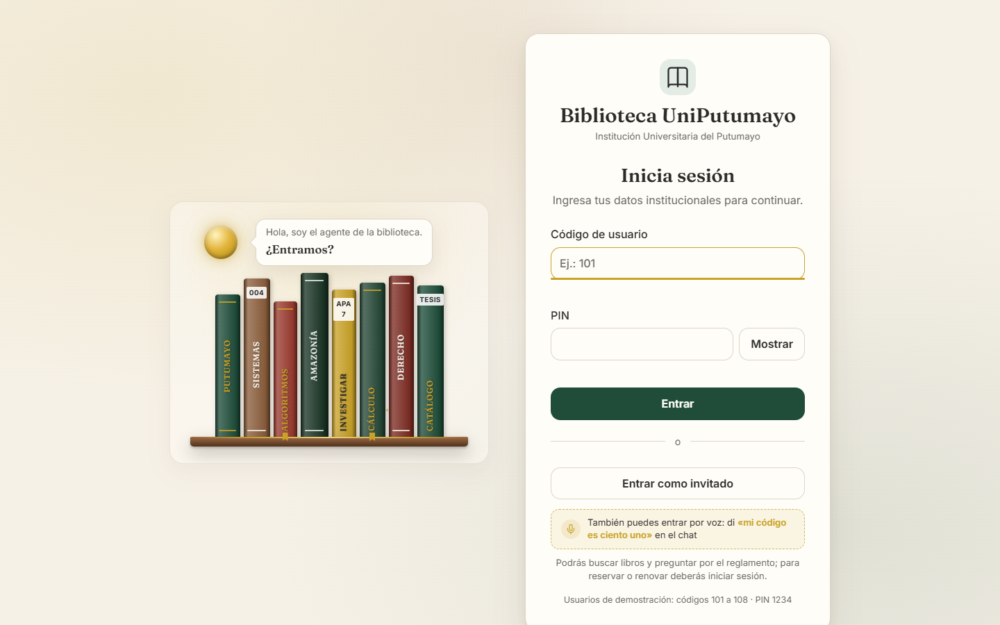
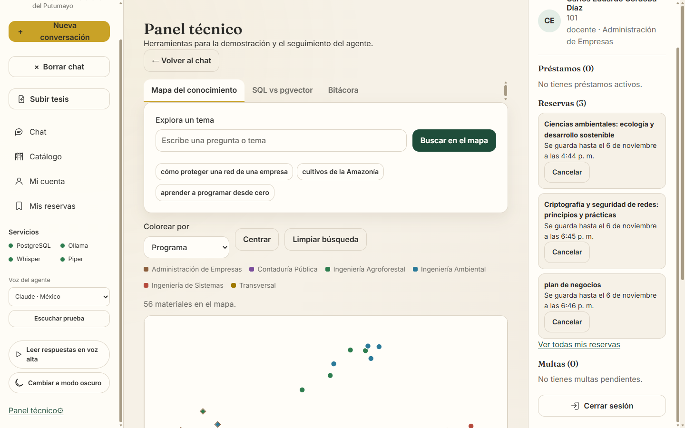
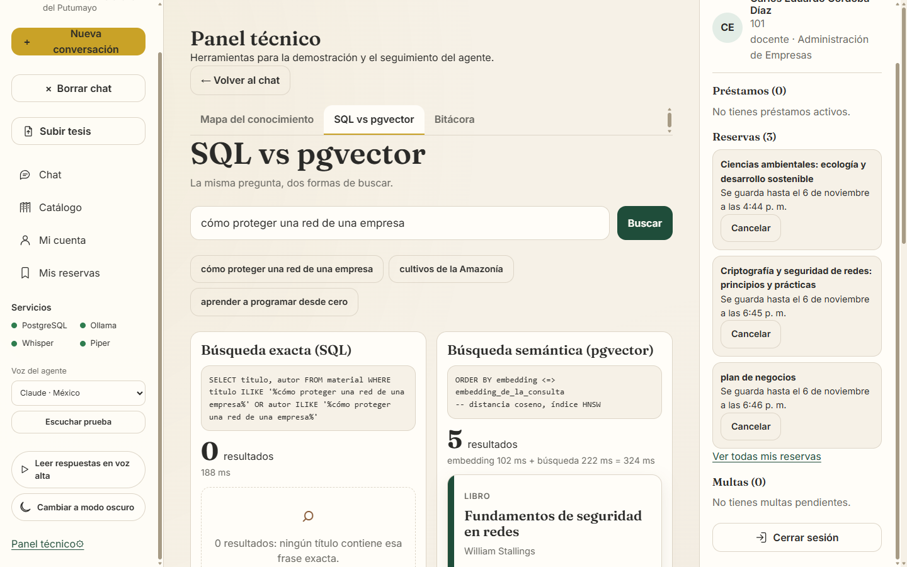
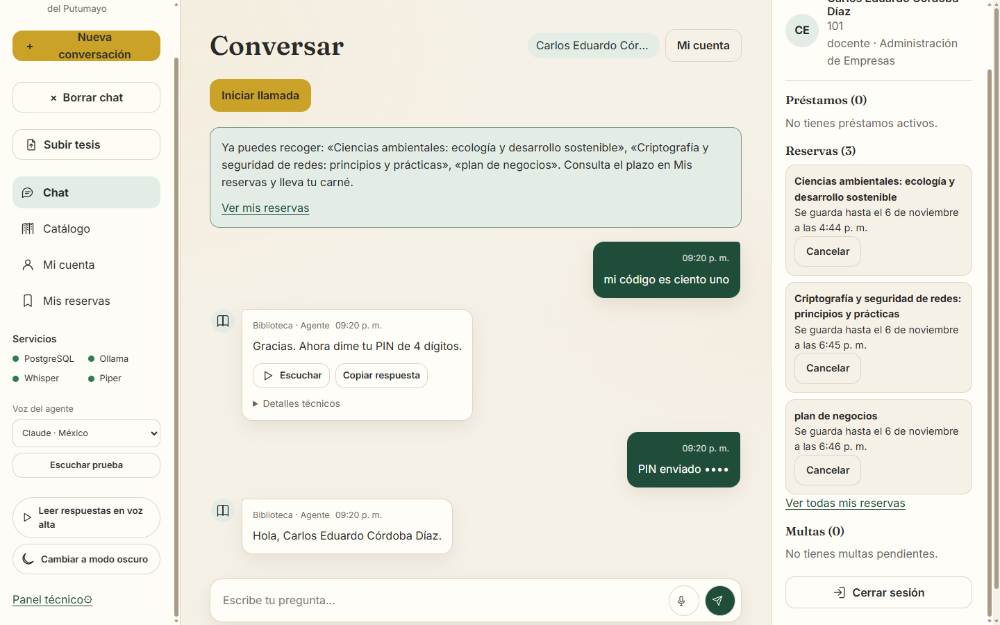
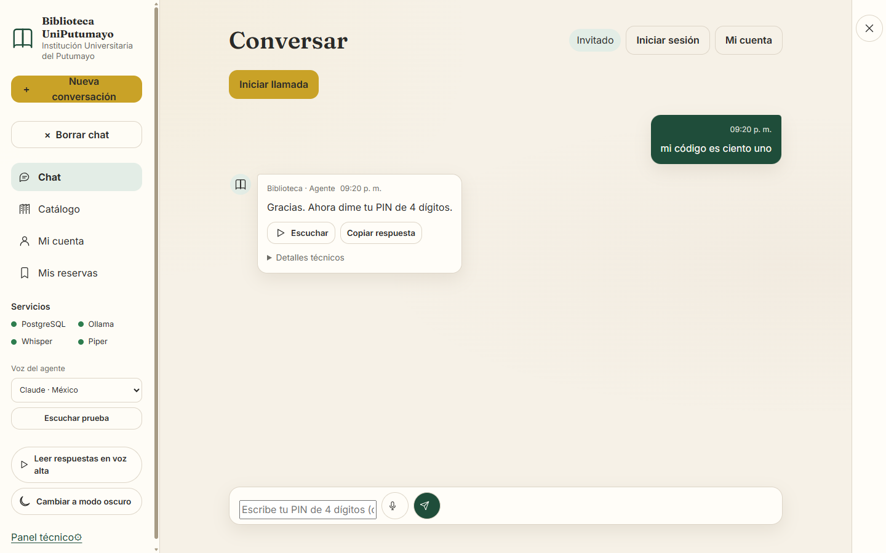

# Agente de Biblioteca y Repositorio Académico — UniPutumayo

Agente conversacional multimodal (texto, voz interactiva y modo llamada manos libres) para la gestión bibliotecaria, consulta de reglamentos, recomendación de acervo, asistencia en investigación académica y depósito de trabajos de grado de la **Institución Universitaria del Putumayo (UniPutumayo)**.

> [!NOTE]
> **Aviso sobre datos de demostración académica**:
> Los usuarios de prueba (códigos 101 a 108), nombres de estudiantes y docentes, autores de tesis de grado, correos electrónicos, estados de préstamo y sanciones son **datos ficticios** creados exclusivamente con fines pedagógicos y de demostración para el taller de Sistemas Expertos. Las obras bibliográficas (títulos de libros, autores clásicos y editoriales) corresponden a referencias académicas reales presentes en bibliotecas universitarias.



### Galería de vistas destacadas del sistema

| Panel técnico · Mapa PCA 2D | Demostración SQL vs pgvector |
|:---:|:---:|
|  |  |
| **Mi cuenta y trámites de préstamo** | **Chat interactivo y PIN enmascarado** |
|  |  |

> [!TIP]
> **Galería visual interactiva completa**: La carpeta [`docs/capturas/`](docs/capturas/) reúne más de 20 capturas de pantalla del sistema verificadas en Microsoft Edge sobre resoluciones de escritorio (1440×900) y móvil (390×844), tanto en tema claro como en tema oscuro. Para recorrer interactivamente todas las pantallas, abre el archivo [`docs/capturas/index.html`](docs/capturas/index.html) en tu navegador web.

---

## 1. Descripción general

El sistema opera de manera **100 % local y en CPU**, sin depender de servicios ni APIs en la nube, garantizando soberanía de datos y privacidad institucional. Integra:
- **Recuperación Semántica Densa (RAG)**: Búsqueda conceptual sobre normativas de biblioteca, manuales de citación APA 7 / IEEE, resúmenes de libros y tesis completas mediante `pgvector` y `embeddinggemma` (768 dimensiones).
- **Operaciones Transaccionales Concurrente**: Reservas, cancelaciones y renovaciones atómicas en PostgreSQL con bloqueos de fila (`SELECT ... FOR UPDATE`) y control estricto de identidad.
- **Interacción Multimodal de Voz**: Transcripción de habla a texto con Faster-Whisper (`base`, cuantización `int8`), síntesis local con Piper TTS (voz neuronal predeterminada `es_MX-claude-high`, voces adicionales y soporte para voz personalizada mediante XTTS-v2).

---

## 2. Requisitos del sistema

- **Sistema operativo**: Windows 10 u 11 (también compatible con Linux y macOS).
- **Hardware**: Procesador moderno de 4 o más núcleos físicos (ej. Intel Core i5 / AMD Ryzen 5) y **12 GB de memoria RAM** mínimos para operar cómodamente todos los modelos en CPU. **No requiere tarjeta gráfica dedicada (GPU)**.
- **Python**: Versión **3.13** recomendada (o 3.11+).
- **PostgreSQL**: Versión **17** con la extensión `pgvector` (0.8.7 o compatible).
- **Ollama**: En ejecución local en `http://127.0.0.1:11434` con los siguientes modelos descargados:
  - `qwen2.5:3b`: Modelo principal para clasificación y despacho de herramientas (*tool calling*).
  - `qwen2.5:1.5b`: Modelo para redacción ágil y respuestas fundamentadas con documentos.
  - `embeddinggemma`: Modelo de representaciones vectoriales densas (768 dimensiones).
- **Voces Piper TTS**: Modelos ONNX y JSON correspondientes en la carpeta `voces/` (`es_MX-claude-high`, `es_MX-ald-medium`, `es_ES-sharvard-medium`).
- **Voz personalizada XTTS-v2 (opcional)**: Coqui TTS con muestra de audio de referencia limpia en la carpeta `voz que quiero/` (bajo licencia comunitaria CPML para fines académicos).

---

## 3. Instalación y puesta en marcha paso a paso

### Paso 1: Clonar y crear el entorno virtual

Abre una terminal de PowerShell en la raíz del proyecto y crea el entorno virtual:

```powershell
# Ubicarse en el directorio del proyecto
cd "C:\Users\ISA\Documents\noveno semestre\sistemas expertos\Agente_biblioteca"

# Crear el entorno virtual con Python 3.13
python -m venv venv

# Activar el entorno virtual
.\venv\Scripts\activate
```

### Paso 2: Instalar dependencias de Python

```powershell
python -m pip install --upgrade pip
pip install -r requirements.txt
```

### Paso 3: Configurar variables de entorno (`.env`)

Copia la plantilla de configuración `.env.example` para crear tu `.env` local:

```powershell
copy .env.example .env
```

Configura tus credenciales en el archivo `.env`. Ejemplo de configuración base:

```ini
PG_HOST=127.0.0.1
PG_PORT=5432
PG_DB=biblioteca_agente
PG_USER=agente_biblio
PG_PASSWORD=tu_contraseña_aqui
PG_ADMIN_USER=postgres
PG_ADMIN_PASSWORD=tu_contraseña_admin_postgres

OLLAMA_HOST=http://127.0.0.1:11434
LLM_MODEL=qwen2.5:3b
LLM_MODEL_RESPALDO=qwen2.5:1.5b
LLM_MODEL_REDACCION=qwen2.5:1.5b
EMBED_MODEL=embeddinggemma
WHISPER_MODEL=base
PIPER_VOZ=voces/es_MX-claude-high.onnx
PIPER_LENGTH_SCALE=0.92

NUM_CTX=2048
NUM_PREDICT=200
KEEP_ALIVE=30m
WHISPER_THREADS=4
```

> [!TIP]
> En Windows se debe usar `127.0.0.1` en vez de `localhost` para evitar que el sistema resuelva primero direcciones IPv6, lo que previene una penalización de hasta 2 segundos por turno.

### Paso 4: Descargar modelos en Ollama

Asegúrate de que Ollama esté iniciado y ejecuta:

```powershell
ollama pull qwen2.5:3b
ollama pull qwen2.5:1.5b
ollama pull embeddinggemma
```

### Paso 5: Descargar modelos de voz Piper

Descarga los modelos neuronales de síntesis local en la carpeta `voces/`:

```powershell
python -m piper.download_voices es_MX-claude-high --data-dir voces
python -m piper.download_voices es_MX-ald-medium --data-dir voces
python -m piper.download_voices es_ES-sharvard-medium --data-dir voces
```

### Paso 6: Inicializar la base de datos PostgreSQL

Ejecuta los scripts SQL en el **orden estricto** indicado a continuación:

```powershell
# 1. Crear usuario agente_biblio y base de datos biblioteca_agente (como superusuario postgres)
psql -U postgres -h 127.0.0.1 -f sql/00_crear_bd.sql

# 2. Crear esquemas (public y conocimiento), tablas, vistas e índices HNSW
psql -U agente_biblio -d biblioteca_agente -h 127.0.0.1 -f sql/schema.sql

# 3. Cargar datos semilla (40 libros, 15 tesis, 103 ejemplares y 8 usuarios demo)
psql -U agente_biblio -d biblioteca_agente -h 127.0.0.1 -f sql/seed.sql

# 4. Migración 01: Autenticación por PIN PBKDF2, sesiones y tokens seguros
psql -U agente_biblio -d biblioteca_agente -h 127.0.0.1 -f sql/migracion_01.sql

# 5. Migración 02: Repositorio institucional y soporte de carga de PDFs de tesis
psql -U agente_biblio -d biblioteca_agente -h 127.0.0.1 -f sql/migracion_02.sql

# 6. Migración 03: Códigos cortos de 3 dígitos (101 a 108) para voz
psql -U agente_biblio -d biblioteca_agente -h 127.0.0.1 -f sql/migracion_03.sql
```

### Paso 7: Configuración de PINs, datos demo, vectorización y verificación

Con el entorno virtual activado, ejecuta la secuencia de preparación:

```powershell
# 1. Asignar el PIN 1234 con algoritmo PBKDF2 a las cuentas demo (101 a 108)
python asignar_pines_demo.py

# 2. Sincronizar los escenarios demo con la fecha actual (condición inicial para pruebas)
python refrescar_demo.py

# 3. Ingestar y vectorizar reglamentos, guías APA/IEEE, reseñas de libros y tesis
python ingestar.py

# 4. Calcular la proyección bidimensional PCA del mapa del conocimiento
python calcular_mapa.py

# 5. Verificar que los 6 componentes críticos funcionen adecuadamente
python verificar_entorno.py
```

> [!IMPORTANT]
> **Recomendación clave antes de la sustentación o demostración**:
> Ejecuta siempre `python refrescar_demo.py` antes de iniciar la sustentación ante el jurado o los evaluadores. Este script reubica los registros operativos de los usuarios demo (101–108) con fechas de préstamo, vencimiento y expiración de reservas relativas al día de hoy (`CURRENT_DATE` / `now()`). Esto asegura que escenarios como el préstamo vencido hace 5 días del usuario 102, los límites de renovación o la reserva en mostrador del usuario 108 funcionen exactamente como se diseñaron. Si solo deseas inspeccionar el estado actual sin modificar la base de datos, utiliza el parámetro `python refrescar_demo.py --solo-mostrar`.

### Paso 8: Ejecución del sistema

Puedes iniciar la aplicación usando el lanzador por lotes o directamente con Uvicorn:

```powershell
# Opción 1: Lanzador automático con comprobación de Ollama y apertura de navegador
.\iniciar.bat

# Opción 2: Ejecución manual directa mediante Uvicorn
python -m uvicorn app.main:app --host 127.0.0.1 --port 8000
```

Accede desde cualquier navegador web a: **http://127.0.0.1:8000**

---

## 4. Arquitectura del sistema

### Diagrama de flujo de datos unificado

```
 ┌────────────────────────────────────────────────────────────────────────────────────────┐
 │                              INTERFAZ DE USUARIO (Navegador)                           │
 │   • Chat interactivo       • Modo llamada (VAD)     • Catálogo con filtros y ficha     │
 │   • Asistente de investig. • Mi cuenta / Reservas   • Subida y vectorización de tesis  │
 │   • Tablero dinámico       • Panel técnico (PCA)    • Consulta y seguimiento académico │
 └─────────────┬───────────────────────────┬───────────────────────────────┬──────────────┘
               │ Texto / JSON              │ Audio WAV (16 kHz mono)       │ Streaming / Form
               ▼                           ▼                               ▼
 ┌────────────────────────────────────────────────────────────────────────────────────────┐
 │                                   FASTAPI (app/main.py)                                │
 │   Endpoints REST: /api/chat, /api/voz, /api/transcribir, /api/investigacion,           │
 │                   /api/catalogo, /api/material, /api/mapa, /api/demo, /api/bitacora,    │
 │                   /api/tesis, /api/cuenta, /api/mis-reservas, /api/login, /api/voces   │
 └─────────────┬───────────────────────────┬──────────────────────────────────────────────┘
               │                           │
               │                           ▼
               │              ┌───────────────────────────┐
               │              │ Faster-Whisper (stt.py)   │  faster-whisper `base` int8 CPU
               │              │ Detección y [PIN oculto]  │  Transcripción a texto
               │              └────────────┬──────────────┘
               │                           │
               ▼                           ▼
 ┌────────────────────────────────────────────────────────────────────────────────────────┐
 │                              AGENTE CONVERSACIONAL (app/agente.py)                     │
 │                                                                                        │
 │  1. Modo híbrido de LLM:                                                               │
 │     • Decisión de herramientas (Tool Calling): Ollama `qwen2.5:3b`                     │
 │     • Redacción ágil con documentos recuperados: Ollama `qwen2.5:1.5b`                 │
 │  2. Despachador de respaldo determinista (reglas y palabras clave)                     │
 │  3. Máquina de estados conversacional y validación de permisos de sesión               │
 └─────────────┬───────────────────────────────────────────┬──────────────────────────────┘
               │                                           │
               ▼                                           ▼
 ┌──────────────────────────────┐            ┌────────────────────────────────────────────┐
 │  PostgreSQL 17 Transaccional │            │   PostgreSQL 17 Vectorial (pgvector)       │
 │  Esquema `public`:           │            │   Esquema `conocimiento`:                  │
 │   • usuarios (PIN PBKDF2)    │            │   • documentos y fragmentos (chunking 500) │
 │   • material y ejemplares    │            │   • embeddinggemma (768 dimensiones)       │
 │   • prestamos, devoluciones  │            │   • índice HNSW (vector_cosine_ops)        │
 │   • multas y reservas        │            │   • mapa_materiales y mapa_pca (PCA 2D)    │
 │   • bitacora_agente          │            │                                            │
 │   • sesiones, cargas_tesis   │            │   Consultas: similitud coseno (<=>),       │
 │  (Transacciones atómicas con │            │   RAG documental y proyección PCA          │
 │   SELECT ... FOR UPDATE)     │            │                                            │
 └─────────────┬────────────────┘            └─────────────┬──────────────────────────────┘
               │                                           │
               └─────────────────────┬─────────────────────┘
                                     ▼
                       ┌───────────────────────────┐
                       │    Piper TTS (app/tts.py) │  `es_MX-claude-high` (length_scale=0.92)
                       │    Síntesis de voz local  │  Voces extra: Ald, Sharvard f/m
                       │    (XTTS-v2 opcional)     │  Respuesta de voz adaptada (max 3 frases)
                       └─────────────┬─────────────┘
                                     │
                                     ▼
 ┌────────────────────────────────────────────────────────────────────────────────────────┐
 │                              RESPUESTA MULTIMODAL UNIFICADA                            │
 │   JSON: { texto, audio_wav_base64, fuentes, materiales, tiempos, avisos, sesion }      │
 └────────────────────────────────────────────────────────────────────────────────────────┘
```

### Separación estricta de esquemas en PostgreSQL

1. **Esquema `public` (Transaccional y Operativo)**:
   - Almacena la estructura relacional de la biblioteca: `usuarios`, `material`, `ejemplares`, `prestamos`, `devoluciones`, `multas`, `reservas`, `conversaciones`, `mensajes`, `bitacora_agente`, `parametros`, `cargas_tesis` y `sesiones`.
   - Garantiza consistencia ACID mediante claves foráneas y transacciones atómicas con bloqueos pesimistas (`SELECT ... FOR UPDATE`) en renovaciones y cancelaciones.
2. **Esquema `conocimiento` (Vectorial y RAG)**:
   - Almacena el acervo de textos procesados para recuperación: `documentos` (reglamentos, guías APA/IEEE, preguntas frecuentes, reseñas de libros y textos completos de tesis) y `fragmentos` (segmentos de texto con vectores de 768 dimensiones).
   - Incorpora índices vectoriales de grafos jerárquicos navegables de mundo pequeño (**HNSW**) mediante el operador `vector_cosine_ops`.
   - Contiene las tablas `mapa_pca` y `mapa_materiales` para la proyección bidimensional.

### Modo híbrido de LLM (3b decide / 1.5b redacta)

Para optimizar la velocidad en entornos puramente de CPU:
- **`qwen2.5:3b` (Decisión)**: Se encarga de la comprensión de la intención del usuario y la selección de la herramienta adecuada con sus argumentos (*tool calling*), aprovechando su mayor capacidad de razonamiento.
- **`qwen2.5:1.5b` (Redacción documental)**: Cuando una herramienta recupera fragmentos normativos o reseñas bibliográficas, este modelo más ligero redacta la síntesis final al usuario. Reduce la latencia de generación de texto a la mitad conservando una alta fidelidad a las fuentes.

### Optimizaciones de rendimiento (Fase A)

| Componente | Antes de optimizar | Con optimización (Fase A) | Beneficio observable |
|---|---|---|---|
| **Conexión de red** | `localhost` | `127.0.0.1` | Elimina la resolución lenta de IPv6 en Windows (ahorro de ~2.000 ms por llamada). |
| **Persistencia de modelos** | `keep_alive` por defecto (5 min) | `KEEP_ALIVE=30m` | Los modelos permanecen en RAM; evita recargas lentas desde disco entre turnos. |
| **Ventana de contexto** | Dinámica / amplia | `NUM_CTX=2048` | Reduce el consumo de memoria RAM y acelera el procesamiento de atención en CPU. |
| **Límite de generación** | Sin límite estricto | `NUM_PREDICT=200` | Evita respuestas verborrágicas innecesarias; acelera la respuesta final. |
| **Hilos de STT Whisper** | Automático (hilos lógicos) | `WHISPER_THREADS=4` | Asignación exacta a núcleos físicos de CPU, eliminando contención de *hyperthreading*. |
| **Cadencia de voz Piper** | `length_scale=1.0` | `PIPER_LENGTH_SCALE=0.92` | Síntesis 8 % más ágil con prosodia y entonación completamente naturales. |
| **Inicialización en frío** | Carga bajo demanda en primer turno | Precalentamiento en `lifespan` | Ollama, Whisper y Piper se inicializan en vacío al arrancar el servidor. |

---

## 5. Herramientas del agente conversacional

El sistema implementa 10 herramientas especializadas en `app/herramientas.py` y `app/agente.py`, complementadas por el endpoint de investigación profunda:

| # | Herramienta | Qué hace | ¿Requiere sesión? | ¿Pide confirmación? |
|:---:|---|---|:---:|:---:|
| 1 | `buscar_semantico` | Recupera libros y tesis por afinidad conceptual y temática usando similitud coseno con `embeddinggemma` (768d). | No | No |
| 2 | `buscar_exacto` | Busca títulos o autores literales en la base de datos relacional mediante consultas SQL `ILIKE`. | No | No |
| 3 | `consultar_disponibilidad` | Consulta ejemplares físicos totales, disponibles, prestados o reservados, estantes y códigos de barras. | No | No |
| 4 | `resumir_material` | Sintetiza de manera extractiva el contenido de una tesis o la reseña académica de un libro. | No | No |
| 5 | `generar_bibliografia` | Construye listas de referencias bibliográficas en formato APA 7 o IEEE basadas estrictamente en la tabla `material`. | No | No |
| 6 | `responder_con_documentos` | Responde consultas sobre reglamento, sanciones, préstamos, horarios y políticas citando fragmentos normativos. | No | No |
| 7 | `consultar_prestamos_y_multas` | Consulta el estado de cuenta: préstamos activos, fechas de vencimiento, multas acumuladas y reservas vigentes. | **Sí** | No |
| 8 | `reservar` | Aparta un ejemplar disponible de un título o ubica al usuario en cola de espera si todas las copias están prestadas. | **Sí** | **Sí** (requiere "sí", "confirmo") |
| 9 | `cancelar_reserva` | Cancela una reserva activa perteneciente exclusivamente al usuario en sesión, liberando el ejemplar en transacción atómica. | **Sí** | **Sí** (requiere "sí") |
| 10 | `renovar_prestamo` | Extiende la fecha de vencimiento de un préstamo por 8 días adicionales si no supera 3 renovaciones, no tiene multas ni reservas ajenas. | **Sí** | **Sí** (requiere "sí") |
| + | *Investigar* (`/api/investigacion`) | Asistente de investigación profunda: recupera hasta 5 materiales y 2 fragmentos literales por obra, genera citas `[material ID]`, detecta subtemas y entrega referencias APA. | No | No |

---

## 6. Salas de la biblioteca (Navegación temática y bibliotecarios)

Como en una biblioteca física universitaria, el usuario no le formula consultas a un catálogo genérico indiferenciado: puede elegir una **Sala temática** de su interés para ser atendido por el **bibliotecario o bibliotecaria especialista** de esa área, quien lo recibe con un saludo personalizado y orienta su búsqueda exclusivamente entre los libros y tesis correspondientes.

### Tabla de salas temáticas y bibliotecarios

| Slug | Sala | Bibliotecario(a) | Icono | Programas académicos y materias agrupadas |
|---|---|---|:---:|---|
| `ingenieria` | Sala de Ingeniería y Tecnología | Andrés | 💻 | **Ingeniería de Sistemas**: programación, algoritmos, arquitectura de computadores, redes, bases de datos, seguridad informática e inteligencia artificial. |
| `agro-ambiental` | Sala de Ciencias Agrarias y Ambientales | Rosa | 🌱 | **Ingeniería Agroforestal** e **Ingeniería Ambiental**: edafología, suelos, cultivos amazónicos (cacao, sacha inchi), silvicultura, cuencas hidrográficas, ecología y desarrollo sostenible. |
| `administracion` | Sala de Administración y Negocios | Camilo | 📈 | **Administración de Empresas**: teorías administrativas, formulación de proyectos, mercadeo, modelos de negocio, gestión del talento y finanzas corporativas. |
| `contaduria` | Sala de Contaduría y Finanzas | Lucía | 🧾 | **Contaduría Pública**: contabilidad financiera, costos y presupuestos, auditoría, revisoría fiscal, normas contables internacionales y tributaria. |
| `investigacion` | Sala de Investigación y Escritura | Elena | ✍️ | **Transversal a todos los programas**: metodología de la investigación científica, técnicas de redacción académica, formulación de tesis de grado y normas de citación (APA 7 e IEEE). |
| *(sin sala)* | Toda la biblioteca | Agente general | 🏛️ | Catálogo institucional unificado completo (55 materiales, 103 copias) sin delimitación por área temática (modo predeterminado si no se elige sala). |

### Cómo se elige y cambia de sala

La selección de sala ocurre de manera natural y conversacional, sin barreras ni pantallas obligatorias:
1. **Mensaje de bienvenida y opciones interactivas**: Al ingresar al chat o pulsar *"Nueva conversación"*, el agente saluda y formula la pregunta: *«¿Qué sala quieres visitar hoy?»*, desplegando las salas disponibles como tarjetas-opciones dentro de la propia burbuja del mensaje.
2. **Por clic**: Pulsando directamente la tarjeta de la sala deseada en la burbuja del chat.
3. **Por lenguaje natural (texto o voz)**: El agente interpreta intenciones como:
   - *"Quiero la sala de ingeniería"* (Andrés saluda y activa la sala `ingenieria`).
   - *"Llévame a la sala de agrarias"* (Rosa saluda y activa `agro-ambiental`).
   - *"La de contabilidad"* (Lucía saluda y activa `contaduria`).
   - *"Cámbiame de sala"* o *"¿Qué salas hay?"* (Muestra las opciones de salas vigentes).
   - *"Toda la biblioteca"* (Desactiva el filtro de sala y regresa al acervo general).
4. **Acceso universal sin importar el perfil**: Cualquier usuario (estudiante o docente de cualquier programa, o invitado sin sesión activa) puede entrar a cualquier sala y cambiar de sala en cualquier momento. La sala no depende del programa del usuario.

### Alcance de filtrado: qué se limita por sala y qué no

- **Operaciones limitadas a la sala activa**:
  - `buscar_semantico`: Búsqueda conceptual densa con `pgvector` y `embeddinggemma`.
  - `buscar_exacto`: Búsqueda léxica SQL por título o autor.
  - `consultar_disponibilidad`: Verificación de copias disponibles y estantes físicos.
  - `resumir_material`: Extracción de contenido de tesis y libros.
  - `generar_bibliografia`: Referencias bibliográficas en formato APA 7 o IEEE.
  - Asistente de investigación (`/api/investigacion`): Búsqueda profunda y citas académicas.
- **Operaciones transversales (no limitadas por sala)**:
  - `responder_con_documentos`: Consultas sobre reglamento de biblioteca, políticas de préstamo, sanciones, horarios y manuales APA/IEEE.
  - Operaciones transaccionales del perfil: `consultar_prestamos_y_multas`, `reservar`, `cancelar_reserva` y `renovar_prestamo`.

### Sugerencia inteligente de otra sala

Si un usuario se encuentra en una sala y consulta por un tema que no tiene materiales allí pero sí en otra sala (por ejemplo, buscar *"libros sobre redes"* estando en la Sala de Contaduría), el agente responde de forma proactiva:
> *"En esta sala no tengo material sobre eso, pero en la Sala de Ingeniería y Tecnología hay 4 resultados. ¿Quieres que te lleve?"*

La respuesta API incluye el objeto `sugerencia_sala` (`{"slug": "ingenieria", "nombre": "Sala de Ingeniería y Tecnología", "motivo": "..."}`), permitiendo el traslado inmediato con un solo clic o respondiendo afirmativamente.

---

## 7. Inicio de sesión y usuarios de demostración

### Tabla de usuarios de demostración

Todas las cuentas demo utilizan el PIN: **`1234`**

| Código | Nombre completo | Rol / Programa | Escenario de prueba para demostración |
|:---:|---|---|---|
| **101** | Carlos Eduardo Córdoba Díaz | Docente · Administración de Empresas | Cuenta al día sin pendientes. Ideal para demostrar reservas y préstamos exitosos. |
| **102** | Mariana Rosero Burbano | Estudiante · Ingeniería Agroforestal | Préstamo vencido (hace 5 días) y multa pendiente de $5.000. **No puede renovar**. |
| **103** | Valentina Cárdenas Rojas | Estudiante · Ingeniería de Sistemas | Préstamo de «Cálculo de una variable» con 3 renovaciones alcanzadas (máximo). **No puede renovar más**. |
| **104** | Juan Sebastián Muñoz Pantoja | Estudiante · Ingeniería de Sistemas | Préstamo activo de «Redes de computadoras», pero tiene reserva de otro usuario (108). **No puede renovar**. |
| **105** | Andrés Felipe Jojoa Gómez | Estudiante · Administración de Empresas | Préstamo al día de «Ingeniería de software» con 0 renovaciones. **Sí puede renovar** (+8 días). |
| **106** | Laura Camila Insuasty Díaz | Estudiante · Contaduría Pública | Préstamo regular al día de «Fundamentos de bases de datos». Cuenta estándar. |
| **107** | Diego Alejandro Chicunque Muñoz | Estudiante · Ingeniería Ambiental | Cuenta al día: devolvió su material y pagó su multa previa. Cuenta limpia. |
| **108** | Paola Andrea Zambrano Erazo | Docente · Ingeniería de Sistemas | Tiene una reserva activa de «Redes de computadoras» lista para recoger en mostrador. |

### Canales de autenticación y soporte de lenguaje natural

1. **Formulario en pantalla (Login rediseñado)**: Ingreso visual mediante el nuevo componente dinámico de biblioteca con campo de usuario, PIN enmascarado y botón para revelar credenciales.
2. **Dictado por chat o voz (`app/numeros.py`)**: Admite números en cifras o palabras habladas:
   - Código: *"mi código es ciento uno"*, *"soy el 101"*, *"código ciento ocho"*.
   - PIN: *"uno dos tres cuatro"*, *"doce treinta y cuatro"*, *"mil doscientos treinta y cuatro"*, *"1234"*.

### Rediseño de la experiencia de inicio de sesión

La pantalla de bienvenida y autenticación fue completamente rediseñada para ofrecer una experiencia estética institucional e interactiva:
- **Escena de biblioteca animada**: Ilustración interactiva de estantería con lomos de libros en movimiento sutil identificados con materias y áreas formativas clave de la institución (*Putumayo, Sistemas, Algoritmos, Amazonía, Investigar APA 7, Cálculo, Derecho, Catálogo, Tesis*). Esta escena animada (estantería y orbe) ahora también aparece en la bienvenida del chat para brindar continuidad visual y una cálida recepción antes de iniciar el diálogo.
- **Orbe luminoso con diálogo**: Un orbe interactivo que flota sobre los libros acompañando al usuario con el saludo *«Hola, soy el agente de la biblioteca. ¿Entramos?»*, reflejando el carácter reactivo y multimodal de la solución.
- **Formulario de acceso limpio y enfocado**: La pantalla de login ya **NO** muestra la ayuda de «entrar por voz» a fin de mantener un acceso despejado y directo (el inicio de sesión por voz dictando código y PIN continúa plenamente disponible dentro del chat).
- **Adaptabilidad completa claro/oscuro**: La escena cuenta con diseño para tema claro ([`docs/capturas/login_dinamico_claro.png`](docs/capturas/login_dinamico_claro.png)) y tema oscuro ([`docs/capturas/login_dinamico_oscuro.png`](docs/capturas/login_dinamico_oscuro.png)).

### Mantenimiento de escenarios demo (`refrescar_demo.py`)

Para garantizar que los escenarios de prueba se mantengan vigentes en cualquier fecha:
- **Sincronización relativa con la fecha actual**: Reubica exclusivamente los registros transaccionales de los usuarios demo (101 al 108) con fechas calculadas respecto a `CURRENT_DATE` y `now()`:
  - **101**: cuenta limpia sin préstamos, multas ni reservas.
  - **102**: préstamo de *«Fundamentos de seguridad en redes»* vencido hace 5 días + multa acumulada de $5.000.
  - **103**: préstamo de *«Cálculo de una variable»* con 3 renovaciones consumidas (tope máximo alcanzado).
  - **104**: préstamo activo de *«Redes de computadoras»* con reserva en cola asignada a otro usuario (108).
  - **105**: préstamo regular de *«Ingeniería de software»* (0 renovaciones) listo para renovar exitosamente (+8 días).
  - **106**: préstamo regular al día de *«Fundamentos de bases de datos»*.
  - **108**: reserva activa en mostrador con vencimiento en 48 horas (`now() + interval '48 hours'`).
- **Integridad del resto del sistema**: Conserva intactos a los usuarios, contraseñas PBKDF2, sesiones activas, acervo bibliográfico, fragmentos vectoriales, conversaciones y bitácora.
- **Modo inspección (`--solo-mostrar`)**: Ejecutar `python refrescar_demo.py --solo-mostrar` permite cotejar el estado actual frente al esperado en consola sin alterar la base de datos.
- **Condición inicial de pruebas**: La suite de evaluación y pruebas unitarias utiliza este estado como punto de partida determinista. Se recomienda encarecidamente ejecutarlo siempre antes de la sustentación presencial o remota.

### Medidas de seguridad implementadas

- **Cifrado de credenciales**: El PIN se almacena con el algoritmo **PBKDF2-HMAC-SHA256** con sal aleatoria de 16 bytes y 200.000 iteraciones.
- **Tokens y sesiones**: Los tokens de sesión se guardan como hashes SHA-256 en la base de datos (tiempo de expiración: 2 horas) y se transmiten mediante cookies `HttpOnly` con directiva `SameSite=Lax`.
- **Protección contra fuerza bruta**: Tras **5 intentos fallidos consecutivos** de ingreso de PIN, la cuenta se bloquea automáticamente durante **5 minutos**.
- **Privacidad y enmascaramiento**: En la transcripción de voz Whisper, en el historial del chat y en la tabla `bitacora_agente`, el PIN se reemplaza inmediatamente por la etiqueta **`[PIN oculto]`**.
- **Avisos proactivos al identificarse**: Tras iniciar sesión con éxito, el agente notifica automáticamente al usuario sobre préstamos vencidos, multas acumuladas, préstamos próximos a vencer (en menos de 48 horas) o reservas listas para recoger en mostrador.

---

## 8. Funciones de la interfaz ("Biblioteca viva")

La interfaz web moderna y responsiva cuenta con tema claro/oscuro y está organizada en vistas accesibles desde el menú lateral:

### A. Chat interactivo y Modo llamada manos libres
- **Tarjetas y botones de acción**: Despliega tarjetas informativas de libros y tesis, opciones interactivas para elegir sala o confirmar trámites y citas de fuentes normativas.
- **Escena interactiva en la bienvenida**: La escena animada de estantería y el orbe luminoso ahora también aparecen en la bienvenida del chat, ofreciendo una recepción visual interactiva antes de iniciar el diálogo.
- **Modo llamada manos libres con VAD**: Conversación continua por micrófono con detección de silencios en el navegador. Envía el turno al terminar de hablar, reproduce la respuesta sintetizada y reactiva el micrófono de forma autónoma.
- **Orbe y ondas de voz**: Animación visual que reacciona a las fases de escucha, procesamiento y síntesis del agente.
- **Reproducción de voz controlada (una sola voz a la vez)**: La voz ya **NO** se lee sola al responder consultas de texto. La lectura automática se activa únicamente al preguntar por voz o cuando el usuario habilita explícitamente el conmutador *"Leer respuestas en voz alta"*. Asimismo, el reproductor garantiza estrictamente **una sola voz a la vez**, cancelando de inmediato cualquier locución en curso antes de emitir una nueva.
- **Diagnóstico conversacional sin panel Rayos X en el chat**: El panel «Rayos X» ya **NO** aparece en el chat para mantener la conversación despejada; su información analítica (intención detectada, herramienta despachada, latencias por etapa y similitud vectorial) se consulta ordenadamente en el menú *"Detalles técnicos"* debajo de cada mensaje y en el Panel técnico (`#panel/mapa`).
- **Selector de voces en vivo y propagación en respuestas**:
  - Conmutación en tiempo real entre voces neuronales locales Piper (`Claude` es-MX predeterminada, `Ald` es-MX, `Sharvard` femenina y masculina es-ES) y voz personalizada mediante **XTTS-v2**.
  - **Propagación en todas las respuestas**: El parámetro `voz_id` se envía en cada petición (`/api/chat`, `/api/voz` y `/api/tts`). En la respuesta JSON, el backend reporta `voz_usada` confirmando la voz real con la que se sintetizó el archivo de audio.
  - **Fallback automático con aviso**: Si una voz solicitada no está disponible o no se reconoce, el backend recurre de inmediato a la voz neuronal estándar (`claude`) y añade un campo `aviso` descriptivo en la respuesta JSON para informar al usuario de manera transparente.
  - **Licencia de voz XTTS-v2**: El uso de XTTS-v2 requiere la aceptación explícita de su licencia no comercial (Coqui Public Model License - CPML) mediante el parámetro `acepto_cpml: true`. Si no se acepta o los pesos no están cargados, el sistema emite el aviso correspondiente y sintetiza con la voz predeterminada sin interrumpir el flujo.

### B. Tablero dinámico en la bienvenida
- **Métricas vivas del acervo**: Contadores en vivo de materiales totales, libros, tesis y copias físicas disponibles.
- **Vitrina viva**: Carrusel de libros y proyectos de grado destacados con accesos rápidos para consultar disponibilidad y explorar la ficha del material.

### C. Catálogo bibliográfico completo
- **Exploración paginada**: 55 títulos y 103 ejemplares con paginación de 12 por página.
- **Filtros cruzados**: Búsqueda por texto (título, autor o tema), filtro por tipo de material (`libro` o `tesis`), filtro por programa académico y conmutador *Solo disponibles*.
- **Ficha modal detallada**: Muestra el resumen unificado del material, ubicación física en estante, estado individual por código de barras y accesos para *Preguntar al agente*, *Ver en el mapa PCA* o *Reservar*.

### D. Asistente de investigación (`#investigacion`)
- Recuperación profunda sobre documentos y tesis completas indexadas en `conocimiento.fragmentos`.
- Filtro opcional por programa académico.
- Citas explícitas `[material ID]` y hasta 2 fragmentos literales entrecomillados por material relevante.
- Detección de subtemas presentes en el catálogo y generación de referencias bibliográficas en norma APA 7 con botón **Copiar**.

### E. Mi cuenta, Mis reservas y Subir tesis
- **Mi cuenta**: Consulta de préstamos activos con fechas formateadas en español y multas pendientes acumuladas.
- **Mis reservas**: Distinción visual entre solicitudes *"Lista para recoger"* (con plazo de 48 horas en mostrador) y solicitudes *"En cola"*, con botón para cancelación inmediata y confirmación modal.
- **Subir tesis (`/api/tesis`)**: Formulario para depositar proyectos de grado en formato PDF (hasta 25 MB y 300 páginas). Procesamiento asíncrono en segundo plano (extracción de texto seleccionable, segmentación semántica, generación de embeddings con `embeddinggemma` e indexación), con barra de progreso en vivo y descarga del documento.

---

## 9. Panel técnico de auditoría y análisis

El panel técnico (`#panel/mapa`) proporciona herramientas para la sustentación y el monitoreo del sistema:

### 1. Mapa del conocimiento (PCA 2D)
- **Reducción dimensional ligera**: Emplea Análisis de Componentes Principales (PCA) calculado mediante centrado y Descomposición en Valores Singulares (**SVD**) con NumPy, transformando el espacio de 768 dimensiones a un plano 2D.
- **Porcentaje de varianza explicada**: Registra la proporción de varianza capturada por el primer y segundo componente principal (`varianza_explicada`).
- **Proyección de consultas en tiempo real (`/api/mapa/proyectar?q=...&k=5`)**: Calcula la similitud coseno rigurosa en el espacio vectorial completo de 768 dimensiones para identificar los *k* materiales más afines, proyectando la consulta como una estrella con trazos visuales hacia los puntos correspondientes.

### 2. Demostración SQL vs pgvector (`/api/demo`)
- Comparación en vivo ante una consulta temática en lenguaje natural (ej. *"cómo proteger una red de una empresa"*).
- Demuestra cómo la búsqueda léxica SQL `ILIKE` falla al no encontrar coincidencias literales exactas (0 resultados), mientras que `pgvector` (`<=>`) recupera los libros y tesis pertinentes por significado conceptual, reportando los tiempos de ejecución en milisegundos.

### 3. Bitácora de auditoría (`/api/bitacora`)
- Registro de turnos conversacionales en `public.bitacora_agente`.
- Desglose cronométrico por etapas:
  - `t_stt_ms`: Reconocimiento del habla con Whisper.
  - `t_embedding_ms`: Generación de embeddings con embeddinggemma.
  - `t_busqueda_ms`: Recuperación vectorial en pgvector.
  - `t_llm_ms`: Inferencia y redacción del modelo de lenguaje.
  - `t_tts_ms`: Síntesis de voz con Piper.
  - `t_total_ms`: Tiempo total del turno conversacional.
- Filtros por búsqueda textual, solo turnos de voz y solo turnos con incidencias.

---

## 10. Evaluación y pruebas automatizadas

El proyecto dispone de una suite completa de pruebas para verificar el rendimiento, la precisión conversacional y la integridad de las bases de datos.

### Scripts de verificación individual

```powershell
# 1. Comprobación de requisitos y servicios del entorno (Fase 0)
python verificar_entorno.py

# 2. Sincronización y verificación del estado demo (condición inicial para pruebas)
python refrescar_demo.py --solo-mostrar

# 3. Pruebas de aceptación conversacional, trámites y máquina de estados
python probar_agente.py

# 4. Pruebas de salas temáticas: navegación, bibliotecarios y contratos
python probar_salas.py

# 5. Pruebas de transcripción STT con Whisper y síntesis TTS con Piper
python probar_voz.py

# 6. Pruebas del selector de voces, consistencia de voz_usada, fallback seguro y WAVs
python probar_voces.py

# 7. Pruebas del repositorio: carga y vectorización de tesis en PDF
python probar_repositorio.py

# 8. Verificación de catálogo: filtros, paginación y estadísticas
python evaluacion/verificar_catalogo.py

# 9. Verificación de investigación: API, citas [material ID] y extractos
python evaluacion/verificar_investigacion.py

# 10. Verificación E2E de interfaz gráfica en Edge con Playwright (OPCIONAL)
#    Nota: Playwright es una herramienta de prueba E2E opcional y NO se instala por defecto
#    en requirements.txt. Para usarla, instalar: pip install playwright && playwright install msedge
python evaluacion/verificar_interfaz.py

# 11. Batería permanente de preguntas típicas con límites de latencia
python probar_preguntas_tipicas.py
```

> [!NOTE]
> **Dependencia opcional de pruebas E2E (Playwright)**:
> El script `evaluacion/verificar_interfaz.py` automatiza Microsoft Edge para verificar que el árbol DOM, las vistas modales y las transiciones del navegador se comporten correctamente. Dado que no forma parte del runtime del agente ni de la evaluación de modelos de lenguaje o audio, **Playwright no está incluido en `requirements.txt`**. Su instalación es estrictamente opcional (`pip install playwright` y `playwright install msedge`) y requiere que el servidor Uvicorn esté en ejecución en `http://127.0.0.1:8000`. Todas las demás pruebas y el evaluador completo funcionan con las dependencias estándar del proyecto.

### Preguntas típicas (batería permanente y metas de latencia)

El agente dispone de una prueba automatizada permanente (`probar_preguntas_tipicas.py`) que mide de punta a punta 30 preguntas de alta frecuencia bajo la sesión del usuario demo `102` (`Mariana Rosero Burbano`, PIN `1234`). El script comprueba la correspondencia de intención, herramienta ejecutada, veracidad de contenido y cumplimiento estricto de los tiempos máximos permitidos:

```powershell
# Ejecución directa in-process mediante TestClient(app)
python probar_preguntas_tipicas.py

# Ejecución contra el servidor Uvicorn activo (http://127.0.0.1:8000)
python probar_preguntas_tipicas.py --servidor

# Medición de estrés manteniendo el historial en una sola conversación continua
python probar_preguntas_tipicas.py --misma-conversacion

# Filtrado selectivo por término de pregunta
python probar_preguntas_tipicas.py --solo "programación"
```

#### Metas de tiempo de respuesta (latencia de punta a punta)

| Tipo de interacción | Meta máxima | Justificación técnica |
|---|:---:|---|
| **Deterministas** (saludo, presentación, trámites directos, cortesía, fuera de dominio) | **≤ 3,0 s** | Enrutador ágil de respuestas directas sin necesidad de inferencia pesada en LLM. |
| **Reglamento con FAQ clara** (días de préstamo, sanciones, horarios, cupos máximos) | **≤ 3,0 s** | Extracción directa y estructurada desde la normativa y FAQs de biblioteca. |
| **Búsquedas conceptuales y de catálogo** (semántica pgvector, exactas SQL, disponibilidad) | **≤ 4,0 s** | Vectorización densa (768d con `embeddinggemma`) y consulta vectorial o relacional. |
| **Síntesis con LLM o resúmenes extensos** | **≤ 10,0 s** | Inferencia y redacción en CPU con modelos locales compactos (Qwen 1.5B/3B). |
| **Promedio global de la batería** | **< 4,0 s** | Meta institucional para garantizar fluidez y experiencia de usuario ágil. |

#### Ejemplos destacados de preguntas típicas evaluadas

| # | Pregunta típica | Intención esperada | Comportamiento y contenido verificado | Meta |
|:---:|---|---|---|:---:|
| 1 | `Hola` | `saludo` / `cortesia` | Saludo cordial e invitación a consultar el acervo | ≤ 3,0 s |
| 2 | `¿Quién eres?` | `presentacion` | Asistente de biblioteca UniPutumayo (no fuera de dominio) | ≤ 3,0 s |
| 3 | `¿Qué puedes hacer?` | `presentacion` | Resumen de servicios: catálogo, préstamos, citas y reservas | ≤ 3,0 s |
| 4 | `¿Qué libros tienes?` | `panorama_catalogo` | Panorama general con desglose numérico de libros y tesis | ≤ 3,0 s |
| 5 | `¿Cuál es el mejor libro de programación?` | `recomendar` | Sugerencias destacadas (Joyanes Aguilar o Deitel) | ≤ 4,0 s |
| 6 | `¿Tienen libros de inteligencia artificial?` | `buscar_semantico` | Recupera obra canónica de Russell y Norvig | ≤ 4,0 s |
| 7 | `¿De qué trata la tesis plan de negocios?` | `resumir_material` | Síntesis extractiva del contenido citando la Fuente | ≤ 4,0 s |
| 8 | `¿Cuál es el libro más prestado?` | `mas_prestados` | Identifica el ejemplar con mayor rotación histórica | ≤ 3,0 s |
| 9 | `¿Dónde encuentro el libro Redes de computadoras?` | `ubicacion_material` | Señalización física en estantería (Estante C-06 / D-01) | ≤ 3,0 s |
| 10 | `¿Cuántos días me prestan un libro?` | `responder_con_documentos` | Cita el reglamento institucional: 8 días de préstamo | ≤ 3,0 s |
| 11 | `¿Cuánto es la multa por día?` | `responder_con_documentos` | Sanción reglamentaria: $1.000 COP diarios por mora | ≤ 3,0 s |
| 12 | `¿Cuántos libros puedo sacar a la vez?` | `responder_con_documentos` | Límite de 3 ejemplares (no confunde con búsqueda temática) | ≤ 3,0 s |
| 13 | `¿Tengo multas?` | `consultar_prestamos_y_multas` | Reporta la multa pendiente de $5.000 para el usuario 102 | ≤ 3,0 s |
| 14 | `Renueva mi préstamo` | `renovar_prestamo` | Deniega la renovación por existencia de sanción activa | ≤ 3,0 s |
| 15 | `¿Cuál es la capital de Francia?` | `fuera_de_dominio` | Declina cortésmente aclarando los límites del agente | ≤ 3,0 s |

### Ejecución de la suite principal de evaluación

El evaluador principal (`evaluacion/evaluar.py`) toma una instantánea del estado de la base de datos antes de iniciar y **la restaura automáticamente** al finalizar, evitando alterar los datos operativos:

```powershell
# Ejecución completa
python evaluacion/evaluar.py

# Modos de ejecución selectiva:
python evaluacion/evaluar.py --sin-audio     # Omite pruebas que requieren audio .wav
python evaluacion/evaluar.py --solo TXT      # Solo casos de conversación por texto
python evaluacion/evaluar.py --solo AUD      # Solo casos de voz y audio
python evaluacion/evaluar.py --solo BIB      # Solo casos de referencias APA/IEEE
python evaluacion/evaluar.py --solo MAPA     # Solo casos de proyección y reducción PCA
python evaluacion/evaluar.py --solo INV      # Solo casos del asistente de investigación
python evaluacion/evaluar.py --solo SALAS    # Solo casos de navegación y filtrado por salas
```

### Resumen del reporte de evaluación (`evaluacion/reporte.md`)

Los siguientes resultados corresponden a la **ejecución completa oficial** de la suite de evaluación sobre la arquitectura híbrida en CPU:

- **Fecha y hora de la ejecución**: **10-nov-2026 14:48** (`2026-11-10T14:48:07-05:00`)
- **Modelo LLM**: `qwen2.5:3b` (respaldo y redacción: `qwen2.5:1.5b`)
- **Modelo de embeddings**: `embeddinggemma` (768 dimensiones)
- **Modelos de voz**: Faster-Whisper `base` (`int8`) y Piper TTS (`es_MX-claude-high`)

| Métrica evaluada | Resultado oficial obtenido |
|---|:---:|
| **Casos ejecutados** | **58** |
| **Casos omitidos por recursos faltantes** | **0** |
| **Acierto de intención** | **100.0 %** (37 / 37 casos evaluados) |
| **Acierto de herramienta (*tool calling*)** | **100.0 %** (37 / 37 casos evaluados) |
| **Precisión de recuperación top-3** | **79.6 %** (18 / 18 casos evaluados) |
| **Comprobaciones superadas** | **207 / 207 (100.0 %)** |
| **Fallos registrados** | **0 fallos** (100 % de éxito) |

### Tiempos promedio por etapa

| Tipo | Etapa | Promedio (ms) | Muestras |
|---|---|---:|---:|
| **Global** | **STT (Faster-Whisper)** | **1.270,0 ms** | 7 |
| **Global** | **Embeddings (embeddinggemma)** | **122,3 ms** | 21 |
| **Global** | **Búsqueda vectorial (pgvector)** | **155,2 ms** | 21 |
| **Global** | **LLM (inferencia y redacción Qwen)** | **6.744,1 ms** | 35 |
| **Global** | **TTS (síntesis de voz Piper)** | **643,4 ms** | 7 |
| **Global** | **Total por turno conversacional** | **5.693,4 ms** | 48 |
| Texto | Embeddings | 132,6 ms | 17 |
| Texto | Búsqueda vectorial | 160,4 ms | 17 |
| Texto | LLM | 6.552,9 ms | 29 |
| Texto | Total turno de texto | 5.800,9 ms | 36 |
| Audio | STT (Faster-Whisper) | 1.270,0 ms | 7 |
| Audio | Embeddings | 69,0 ms | 3 |
| Audio | Búsqueda vectorial | 137,0 ms | 3 |
| Audio | LLM | 8.131,0 ms | 5 |
| Audio | TTS (Piper) | 643,4 ms | 7 |
| Audio | Total turno de audio | 8.243,0 ms | 7 |

### Resultados detallados por categoría (58 casos)

| Categoría | Pasa/total | Omitidos | Intención | Herramienta | Precisión top-3 | Comprobaciones |
|---|---:|---:|---:|---:|---:|---:|
| `bibliografia` | 5/5 | 0 | 100.0% | 100.0% | 66.7% | 29/29 |
| `busqueda_exacta` | 3/3 | 0 | 100.0% | 100.0% | 100.0% | 9/9 |
| `busqueda_semantica` | 5/5 | 0 | 100.0% | 100.0% | 75.0% | 11/11 |
| `cancelar_reserva` | 3/3 | 0 | 100.0% | 100.0% | N/D | 14/14 |
| `citacion` | 5/5 | 0 | 100.0% | 100.0% | 55.6% | 15/15 |
| `cuenta` | 2/2 | 0 | 100.0% | 100.0% | N/D | 6/6 |
| `fuera_de_dominio` | 3/3 | 0 | 100.0% | 100.0% | N/D | 7/7 |
| `investigacion` | 4/4 | 0 | N/D | N/D | 100.0% | 21/21 |
| `login` | 6/6 | 0 | N/D | N/D | N/D | 17/17 |
| `login_voz` | 6/6 | 0 | 100.0% | 100.0% | N/D | 26/26 |
| `mapa` | 4/4 | 0 | N/D | N/D | 100.0% | 8/8 |
| `privacidad` | 1/1 | 0 | 100.0% | 100.0% | N/D | 5/5 |
| `reglamento` | 4/4 | 0 | 100.0% | 100.0% | 66.7% | 13/13 |
| `renovacion` | 3/3 | 0 | 100.0% | 100.0% | N/D | 11/11 |
| `reserva` | 2/2 | 0 | 100.0% | 100.0% | N/D | 7/7 |
| `subir_tesis` | 2/2 | 0 | N/D | N/D | N/D | 8/8 |
| **Total general** | **58/58** | **0** | **100.0%** | **100.0%** | **79.6%** | **207/207** |

---

## 11. Consideraciones éticas y uso responsable

- **Privacidad y aislamiento de perfiles**:
  - Cada usuario puede acceder y operar únicamente sobre sus propios datos de cuenta (préstamos, reservas y multas). El sistema bloquea cualquier intento de consultar o cancelar reservas ajenas.
  - El modelo LLM nunca manipula directamente identificadores confidenciales ni tiene la capacidad de consultar registros de otros usuarios.
  - El PIN no se almacena en texto claro: se protege mediante PBKDF2 con sal y se sustituye por `[PIN oculto]` en transcripciones y bitácoras.
- **Mitigación rigurosa de alucinaciones**:
  - El agente opera bajo un principio estricto de extracción documental (*grounding*): toda información sobre disponibilidad, fechas, sanciones o reglamentos proviene de consultas SQL o fragmentos indexados.
  - En la generación de bibliografía, las referencias se construyen únicamente a partir de las columnas reales de la tabla `material`, empleando `(s. f.)` si falta el año y prohibiendo la invención de DOIs, páginas o URLs inexistentes.
  - Cuando una consulta es ajena al ámbito de la biblioteca o de la universidad (deportes, recetas, cine, pronóstico del tiempo), el agente reconoce explícitamente sus límites y declina cortésmente responder.
- **Soberanía tecnológica**:
  - Todo el procesamiento de inteligencia artificial (LLM, embeddings, reconocimiento de voz y síntesis) corre en la máquina local o servidor universitario, asegurando que ninguna información institucional viaje a proveedores externos.

---

## 12. Limitaciones técnicas conocidas

1. **Datos de demostración**: El acervo de usuarios y trámites operativos es simulado para el contexto del taller universitario.
2. **Ejecución exclusiva en CPU**: El procesamiento en CPU sin aceleración por GPU genera latencias de entre 1,5 y 4 segundos por turno según el nivel de carga del procesador y la cantidad de fragmentos recuperados.
3. **Ausencia de OCR en el repositorio**: El sistema procesa texto digital nativo seleccionable en archivos PDF (a través de `pypdf`). Los trabajos escaneados como imagen requieren un proceso previo de digitalización OCR antes de su carga.
4. **Reducción de dimensionalidad aproximada**: La proyección cartesiana 2D mediante PCA conlleva una pérdida natural de varianza explicada respecto al hiperespacio original de 768 dimensiones. Por ello, la interfaz utiliza el plano 2D para visualización general, mientras que la recuperación semántica y los vecinos más cercanos se calculan siempre en el espacio vectorial completo de 768 dimensiones.
5. **Modelos compactos**: Los modelos de 3B y 1.5B parámetros son livianos y eficientes en CPU, pero requieren prompts precisos y herramientas bien delimitadas para evitar redundancias en diálogos prolongados.

---

## 13. Estructura del proyecto

```
Agente_biblioteca/
├── app/
│   ├── __init__.py
│   ├── agente.py            # Orquestación conversacional, herramientas y modo híbrido
│   ├── auth.py              # Autenticación con PIN PBKDF2, tokens y sesiones seguras
│   ├── config.py            # Parámetros del sistema y optimizaciones de rendimiento
│   ├── consultas.py         # Normalización léxica y limpieza de cadenas de búsqueda
│   ├── db.py                # Conexión transaccional y pool con PostgreSQL / psycopg3
│   ├── formatos.py          # Formateo de fechas en español y valores monetarios en COP
│   ├── herramientas.py      # Implementación de las 10 herramientas del agente
│   ├── ingesta.py           # Lectura, chunking semántico y vectorización de textos
│   ├── investigacion.py     # Asistente de investigación profunda y citas normalizadas
│   ├── main.py              # Aplicación FastAPI, ciclo de vida (lifespan) y endpoints REST
│   ├── mapa.py              # Cálculo de reducción dimensional PCA (SVD) con NumPy
│   ├── numeros.py           # Traducción de números y códigos en palabras a dígitos
│   ├── rag.py               # Búsquedas semánticas densas con pgvector y embeddinggemma
│   ├── repositorio.py       # Procesamiento y carga asíncrona de PDFs de tesis
│   ├── salas.py             # Mapeo de programas, conteos reales y bibliotecarios de salas
│   ├── stt.py               # Reconocimiento de voz con Faster-Whisper (int8 en CPU)
│   └── tts.py               # Síntesis local con Piper TTS y soporte XTTS-v2
├── sql/
│   ├── 00_crear_bd.sql      # Creación de base de datos, rol agente_biblio y esquemas
│   ├── schema.sql           # Esquemas public y conocimiento, tablas e índices HNSW
│   ├── seed.sql             # Semilla: 40 libros, 15 tesis, 103 copias y 8 usuarios demo
│   ├── migracion_01.sql     # Migración: PIN con hash, control de intentos y sesiones
│   ├── migracion_02.sql     # Migración: Repositorio institucional y cargas de tesis
│   └── migracion_03.sql     # Migración: Códigos cortos de 3 dígitos (101 a 108)
├── static/
│   ├── css/                 # Estilos modulares (variables, base, componentes, dinamico)
│   ├── js/                  # Módulos ES6 (chat, salas, catálogo, llamada VAD, mapa)
│   └── index.html           # Interfaz web unificada de la biblioteca
├── evaluacion/
│   ├── audios/              # Muestras de audio para evaluación de voz
│   ├── casos_prueba.json    # Banco de casos automatizados declarativos
│   ├── evaluar.py           # Suite de evaluación con aislamiento y restauración
│   ├── reporte.md           # Reporte cuantitativo generado automáticamente
│   ├── resultados.json      # Métricas y tiempos desagregados en formato JSON
│   ├── verificar_catalogo.py
│   ├── verificar_interfaz.py
│   └── verificar_investigacion.py
├── docs/
│   └── capturas/            # Capturas de pantalla para la documentación
├── voces/                   # Modelos ONNX de Piper y metadatos JSON
├── repositorio/             # Tesis digitales en PDF
├── .env.example             # Plantilla de variables de entorno recomendadas
├── asignar_pines_demo.py    # Asignación de PIN PBKDF2 a usuarios de prueba
├── refrescar_demo.py        # Sincronización de fechas y estado operativo para demos
├── calcular_mapa.py         # Script para cálculo y actualización del PCA
├── ingestar.py              # Script para ingesta de documentos y fragmentos
├── iniciar.bat              # Script de inicio rápido en Windows
├── probar_agente.py         # Prueba de aceptación de lógica y máquina de estados
├── probar_preguntas_tipicas.py # Prueba permanente de 30 preguntas típicas con límites de tiempo
├── probar_repositorio.py    # Prueba de aceptación de depósito de PDFs
├── probar_salas.py          # Prueba de aceptación de salas temáticas y bibliotecarios
├── probar_voz.py            # Prueba de aceptación de STT y TTS
├── probar_voces.py          # Prueba de selección de voces, voz_usada, fallback y WAVs
├── requirements.txt         # Dependencias directas de Python 3.13
└── verificar_entorno.py     # Verificación de los 6 servicios críticos del sistema
```

---

## Créditos

- **Proyecto**: Agente Conversacional y Repositorio Académico
- **Asignatura**: Sistemas Expertos (Noveno Semestre)
- **Institución**: Institución Universitaria del Putumayo (UniPutumayo)
- **Sede**: Mocoa, Putumayo, Colombia
